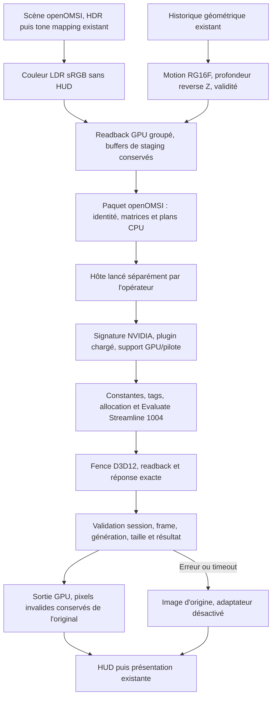

# DLSS 5 : audit communautaire et adaptateur externe openOMSI

Audit et développement du 27 octobre 2026.

**Rapport historique LEVEL 2.** La suite du développement, l'adaptateur NGX optionnel,
la capture/relecture et les commandes Windows actuelles sont dans
[DLSS5_RUNTIME_VALIDATION.md](DLSS5_RUNTIME_VALIDATION.md).
Le bilan ci-dessous conserve les résultats de la phase précédente.

**LEVEL 2 — BACKEND IMPLEMENTED, au périmètre du prototype de transport.**
Le moteur possède un chemin réel de capture, requête externe, validation de réponse,
composition et fallback. Ses composants contrôlables ont été testés sur CPU et GPU.
L'exécuteur Windows appelle réellement les API publiques Streamline et a été compilé
et lié pour Windows. **Il n'a pas été exécuté sous Windows. Aucun runtime Neural
Rendering NVIDIA n'a été exécuté, aucune image DLSS 5 réelle n'a été affichée.**
Les niveaux 3, 4 et 5 ne sont pas atteints. Les compteurs positifs des fixtures de test
sont synthétiques et ne constituent aucune preuve d'inférence.

Le [rapport initial](DLSS5_INTEGRATION.md) décrit les ressources temporelles conservées.

## Préservation et environnement

- Base Git : `f3a1f299709f2fcc49c57ac1209010840a8376e8`.
- Branche créée : `experimental/dlss5-community`, avec les modifications existantes.
- Aucune remise à zéro, suppression du travail utilisateur ou modification de pilote.
- Sauvegarde avant ces développements :
  `target/dlss5-community/level1-before-community.tar.gz`.
  SHA-256 : `036f03730f33a6709a4a1484a1846bcdaedb633d4a2636f7148c8d93be893d77`.
  L'archive contient 35 fichiers, leurs empreintes, le commit de base et un patch
  binaire des fichiers suivis. Les contenus ont été relus et vérifiés après création.
  Conserver l'archive ailleurs avant un `cargo clean`.
  Pour restaurer, extraire dans un dossier neuf : `manifest.json` décrit la base
  et les SHA, `files/` contient les chemins à réappliquer dans un checkout séparé
  de ce commit. Ne pas écraser les modifications ultérieures de la copie courante.
- Environnement revérifié : Linux, NVIDIA GeForce RTX 4050 Laptop, Vulkan,
  pilote NVIDIA `595.99.02`. Aucun test Windows/GPU NR n'est déduit de cet inventaire.
- SDK local présent : `/home/bechir/Bureau/streamline-sdk-v2.14.16`.
  Les en-têtes, sources et DLL publiques ordinaires sont présents. Les composants
  NR requis par le prototype, notamment `sl.dlss_nr.dll` et `nvngx_dlssnr.dll`,
  et l'en-tête/guide de configuration NR dédié, sont absents du SDK inspecté.

La [FAQ NVIDIA](https://www.nvidia.com/en-us/geforce/forums/game-%20ready-drivers/13/583738/dlss-5-faq/)
décrit le support de lancement sur RTX 50 et une extension RTX 40 envisagée.
La RTX 4050 et ce pilote ne sont donc pas une preuve de compatibilité NR.
L'hôte respecte le résultat du runtime pour le GPU et le pilote.

## Sources, commits et licences

Les fichiers texte ont été récupérés dans un dossier de travail extérieur au dépôt.
Aucun binaire communautaire n'a été téléchargé ou exécuté. Le
[manifeste des 58 sources](DLSS5_COMMUNITY_SOURCES.json) conserve dépôt, commit,
chemin et SHA-256 de chaque fichier étudié. Aucun projet entier n'a été copié.

| Source | Révision exacte | Licence et réutilisation |
| --- | --- | --- |
| [UniversalDLSS5](https://github.com/MotionflowOffical/UniversalDLSS5/tree/369872ffb80a2bd8a4f8e3469f5b40e515fcc0f6), CMake 0.5.1 | `369872ffb80a2bd8a4f8e3469f5b40e515fcc0f6` | Apache-2.0, LICENSE et NOTICE lus. Architecture étudiée ; aucun code, hook, forwarder ou exécutable repris. Les SDK NVIDIA et MinHook ont leurs propres conditions. |
| [DLSS5-AIO](https://github.com/SenjuWoo/dlss5-aio/tree/c2803c9c8e92df11cc749f4971312ae38eff6179) | `c2803c9c8e92df11cc749f4971312ae38eff6179` | MIT pour l'assemblage et les modifications AIO. Autopilot adapté à `f7e347c6493361e30c6609f40be66ee2e77677ce`, également MIT. Aucun installateur ni composant embarqué réutilisé. |
| [RHI releases](https://github.com/RankFTW/rhi-repo/releases) | Arbre `1cf1f5dce5b31c49547198f93b4ca560bc1edd40` ; métadonnées de releases consultées le 27/10 | L'arbre inspecté contient des bases JSON et deux INI, sans licence générale de runtimes. Les droits des DLL/addons ne peuvent pas être établis par cet arbre. Aucun asset téléchargé. |
| [Streamline officiel](https://github.com/NVIDIA-RTX/Streamline/tree/625db07d4bca5abc67d781c42af7e7fb0761f1b6) | SDK local 2.14.16 ; tag/source audité `625db07d4bca5abc67d781c42af7e7fb0761f1b6` | API publiques et en-têtes locaux utilisés pour compiler l'hôte. En-têtes non vendus dans ce patch ; binaires NVIDIA non redistribués. Les notices du SDK et les conditions des runtimes restent applicables. |

Le nouveau code openOMSI conserve la licence AGPL-3.0-only du projet. La licence MIT
ou Apache d'un outil communautaire ne donne aucun droit supplémentaire sur les DLL
NVIDIA, les poids du modèle ou leurs redistributions. La séparation en processus
est une décision technique ; elle ne certifie pas les droits d'utilisation.

### UniversalDLSS5 : ce qui existe dans les sources

Les familles de fichiers examinées sont notamment `src/neural`, `src/host`,
`src/gpu`, les interfaces `include/udlss`, les exemples de provider, les tests et les
documents de handoff. Le manifeste contient les chemins complets.

| Mécanisme | Implémentation constatée | Limite pour openOMSI |
| --- | --- | --- |
| Interception et détection | Bridge DXGI/D3D et façade Vulkan Windows, capture à la présentation ; routes natives et traduites séparées | L'annonce Vulkan utilise l'environnement Win32/D3D ; elle ne prouve aucun backend Linux natif. |
| Couleur et guides | Pipeline D3D12 natif, conversion de couleur, profondeur et motion guides ; choix entre guides moteur et estimations | Les guides estimés et les images de présentation ne remplacent pas l'historique géométrique déjà disponible dans openOMSI. |
| Provider moteur explicite | `game_guides_api.hpp`, exports V1/V2, références COM AddRef et métadonnées de caméra | L'interface de ressources prend un device/context D3D11. On ne peut pas lui fournir un pointeur de texture wgpu/D3D12 à la place. |
| Partage natif externe | `external_host_protocol.hpp`, ABI 8 : mapping Win32, LUID, handles de cinq textures et d'une fence ; événements et numéros de frame | Il faut importer les ressources, respecter COMMON, conserver les références et attendre la fence de la frame exacte. Un événement seul ne suffit pas. |
| Hôte | `host/main.cpp` : device D3D12 sur l'adaptateur désigné, ouverture des handles transférés, commandes propres, signal de sortie | Son exécutable communautaire n'est pas lancé par openOMSI. |
| Exécution NGX | `ngx_nr.cpp` et l'hôte utilisent `NVSDK_NGX_Feature_Reserved18` ; paramètres NR observés, allocation et Evaluate | Il s'agit d'un contrat privé/reconstitué. Il n'est pas interchangeable avec Streamline 1004. |
| Exécution Streamline | `streamline_nr.cpp` utilise `slInit`, support/requirements, constantes, tags et `slEvaluateFeature` pour 1004 | Code examiné, pas preuve d'exécution locale. Des alias de tags du backend communautaire ne sont pas repris. |
| Sécurité matérielle | Le code de l'hôte possède une option de remappage d'architecture via hook NVAPI | Ce mécanisme est exclu de notre hôte. Aucun remappage, contournement ou tentative sur GPU refusé. |
| Identité et fallback snippet | Chemin de snippet avec identifiant d'application tiers et paramètres sans en-tête NR public | Non repris ; seul l'identifiant de projet fourni par l'opérateur est utilisé. |
| Tests | Tests de contrats, de synchronisation, de pipeline visuel et chemins conditionnés à un runtime fourni | Ils n'ont pas été exécutés ici ; leurs assertions et préconditions ont été étudiées. Un test de copie ou de shader n'est pas un test du modèle. |

Le document de correction Feature-18 décrit également des sorties sombres/résiduelles
malgré un résultat Evaluate réussi. Cela renforce la nécessité d'inspecter l'image
réelle et le contrat de couleur, au-delà du code de retour.

### DLSS5-AIO : installateur et diagnostic

L'application Python adapte le moteur d'installation Autopilot. Les modules
`components`, `installer`, `sources`, `pe`, `runtimecatalog`, `vulkan`, `verdicts` et
`diagnose/{evidence,routes,live}` ont été lus. Le choix d'une route repose sur les
exécutables, leur architecture, les intégrations reconnues, les composants présents
et les preuves de logs de la session. NGX, Feeder, RenoDX/ReShade, bridges et Remix
restent des composants distincts ; AIO n'est pas une bibliothèque d'inférence moteur.

Le code sépare présence/installation, chargement et frames réellement livrées.
Les diagnostics évitent de compter comme livrées les frames seulement enregistrées
ou dont l'évaluation a échoué. Les sauvegardes, empreintes d'appartenance et opérations
stagiées permettent restauration et conservation des modifications ultérieures.
Leurs tests d'installation ne certifient pas une image openOMSI.

Le catalogue contrôle taille, SHA-256, format PE et famille de runtime. Pour les
nouveaux candidats NVIDIA sans empreinte de DLL déjà épinglée, il exige une signature
Authenticode valide et l'éditeur NVIDIA. La recherche dynamique SR/FG/RR ne constitue
pas une recherche du modèle NR. Aucun script d'installation AIO n'a été lancé ici.

### RHI : inventaire des publications, sans validation de leurs DLL

| Composant nommé | Fonction annoncée / interface | Ce qui reste inconnu ici |
| --- | --- | --- |
| `nvngx_dlssnr.dll` | Runtime propriétaire NGX Neural Rendering ; utilisé par les routes D3D12 Feature-18 étudiées | Empreinte de la DLL, FileVersion effective, architecture PE, signature, intégrité, dépendances exactes et droits des bytes publiés non vérifiés. Le nom d'archive n'est pas une certification. |
| `sl.dlss_nr.dll` | Plugin Streamline qui expose la feature 1004 et utilise le runtime NR | Absence confirmée du SDK local. Présence et contenu exacts dans les ZIP communautaires non vérifiés. Ce plugin n'est pas le runtime NGX lui-même. |
| `renodx-dlss5.addon64` | Addon de capture/interop/traitement dépendant de son environnement RenoDX/ReShade | Pas un plugin wgpu et pas un substitut au modèle NVIDIA. Version, signature et licence du binaire exact non inspectées. |

Métadonnées GitHub observées, **SHA-256 des archives uniquement**, pas des DLL :

| Release / asset | Taille en octets | Digest publié par GitHub |
| --- | ---: | --- |
| [dlssnr-310.9.16](https://github.com/RankFTW/rhi-repo/releases/tag/dlssnr-310.9.16), `nvngx_dlssnr_310.9.16.zip` | 192378839 | `dbeb1f2790b5c621887db99b1a56ac8bd5cb35207e8c074cbb806710f7460cab` |
| [streamline-2.14.16.0-v2](https://github.com/RankFTW/rhi-repo/releases/tag/streamline-2.14.16.0-v2), `streamline_2.14.16.0-v2.zip` | 4116590 | `72bd6b55920eef6ac624d1b253e3b1a06927e84a6e34f1c85ebec0aafd3ffa07` |
| [renodx-dlss5-10.8.0](https://github.com/RankFTW/rhi-repo/releases/tag/renodx-dlss5-10.8.0), `renodx-dlss5_10.8.0.zip` | 2635198 | `faba7814fa90b6b21786c98a45732dbe80f01fa36745c46324472e14ac0f440d` |

Ces valeurs n'ont pas été recalculées sur les archives : elles décrivent les métadonnées
de publication. Aucune signature NVIDIA, licence ou compatibilité GPU n'en est déduite.

## Choix d'architecture

| Approche | Faisabilité, synchronisation et coût | Plateformes / maintenance / droits |
| --- | --- | --- |
| Streamline dans le moteur | Possible avec le device wgpu, mais nécessite command list, états, descriptor heaps et présentation correctement intégrés. Plugin/config NR toujours requis. | Voie Windows DX12 ; pas de preuve Linux. Maintenance du fork et bridge natif plus importante. Runtimes propriétaires nécessaires. |
| Hôte GPU partagé ABI 8 | Réaliste pour réduire les copies : NT handles, même LUID, fences et COMMON. Deux devices ne peuvent partager arbitrairement une texture. | Windows ; adaptateur natif et hôte communautaire à auditer/modifier avant toute utilisation. Aucune voie Linux native démontrée. |
| Petite extension wgpu | Le fork expose maintenant import avec état initial et `transition_resources`. Son encoder DX12 garde la command list privée. Une extension minimale pourrait venir après un premier résultat NR. | Aucun patch du fork dans cette intervention. Exige tests DX12 réels et respect de l'ownership. |
| Hook à la présentation | Rapide pour une application compatible avec les outils existants ; guides, transparences et HUD moins contrôlables. | Windows, proxies/addons/versions spécifiques. Ne résout pas automatiquement wgpu ou Linux. Non retenu pour le moteur. |
| **Hôte séparé avec staging CPU** | **Retenu pour le premier prototype** : API wgpu sûres, buffers mappés après fin GPU, paquet exact, puis upload indépendant dans le device de l'hôte. Retour CPU et composition GPU. Beaucoup plus lent qu'un partage natif. | Client Windows DX12 ou Vulkan, hôte Windows DX12. Code propre à openOMSI, appels Streamline publics. Aucun binaire communautaire lancé, aucune extension du fork requise. |

Ce choix donne un chemin contrôlable sans deviner l'ABI NGX privée ni modifier wgpu.
Le nouvel hôte ne parle **pas** l'ABI 8 UniversalDLSS5 : il utilise le protocole openOMSI
v1 ci-dessous. Remplacer notre hôte par `UniversalDLSS5.NRHost.exe` ne fonctionne pas.
Le transport est volontairement synchrone pour conserver la frame exacte : il peut
ralentir fortement le jeu. Il ne constitue pas une intégration destinée à être livrée.

## Pipeline implémenté



### Ressources et constantes

- Une couleur intermédiaire de même format sRGB que la cible évite de demander
  `COPY_SRC` au swapchain. Les cibles, pipelines et quatre buffers de staging sont
  conservés entre frames et recréés au changement de dimensions/format.
- Une soumission wgpu groupe les copies couleur/motion/profondeur/validité. Les
  quatre mappings sont attendus après la fin GPU. Aucun pointeur HAL n'est transmis.
- Couleur réseau/fichier : RGBA8, valeurs sRGB LDR déjà tone-mappées. Conversion BGRA
  vers RGBA si nécessaire. Le retour est chargé dans une texture sRGB ; la composition
  effectue le décodage/encodage matériel habituel, sans second tone mapping.
- Motion : RG16F vers RG32F CPU. Direction inchangée : pixel précédent moins pixel
  courant, X droite, Y bas. L'hôte fournit `mvecScale=(1/width,1/height)` à Streamline.
- Profondeur : copie des floats 0..1 reverse Z dans R32F ; `depthInverted=true`.
- Les valeurs non finies sont neutralisées et invalidées. La validité R8 reste une
  donnée moteur et **n'est pas assimilée au tag NVIDIA UpliftControlMask**.
- Les matrices de clip sont rebased à l'origine de la frame courante. Les matrices
  Streamline sont transposées mathématiquement pour ses vecteurs ligne, stockées en
  row-major. La base de caméra vient de l'inverse de la vue réelle : droite, haut
  orthogonal et axe +Z de la vue RH, opposé à la direction du regard du moteur.
  Position relative à l'origine ; aucun passage prématuré de coordonnées absolues en f32.
- Jitter nul, motion non jittered, non dilated, caméra incluse. Aucun jitter requis
  par un contrat privé n'est inventé. L'exposition HDR du moteur est déjà appliquée
  dans la couleur LDR ; aucun réglage NR d'exposition non documenté n'est fabriqué.
- Le prototype exige une échelle de rendu de 100 % et au plus 3840×2160 pixels.
  Une résolution interne différente désactive le prototype et conserve le rendu normal.
  FSR 1 reste disponible sur le chemin habituel.

Les effets non couverts par les guides initiaux restent une limite. Ciel et pixels
invalides sont remis à l'original après l'évaluation. Cela ne garantit pas l'absence
d'influence sur les pixels voisins dans le modèle. Les transparences, pluie/vitrages,
particules et reflets demandent encore une stratégie NR validée.

Le HUD final est retiré avant capture puis redessiné après sortie/fallback. Les
compteurs, IBIS, girouettes et panneaux rendus dans le monde 3D ne sont pas des overlays
et ne sont pas protégés par cette règle. Miroirs, triple écrans et XR ne sont pas envoyés
à l'hôte ; leurs chemins existants continuent de fonctionner.

### Protocole propre à openOMSI

Le [codec Rust](../crates/omsi-render/src/nvidia/external/protocol.rs) et le
[codec C++](../tools/neural-host/protocol.hpp) ne partagent aucune structure mémoire
native : entiers et floats sont sérialisés explicitement en little-endian.

| Octets de l'en-tête de 384 octets | Contenu |
| --- | --- |
| 0..15 | Magic `OMSINR01`, version 1, type requête 1 ou réponse 2 |
| 16..31 | Nonce de session u64 et numéro de frame u64 |
| 32..47 | Génération u32, largeur, hauteur, flags reverse-Z/reset/sRGB |
| 48..63 | Taille du payload u64, étapes u32, résultat i32 |
| 64..383 | 80 floats : quatre matrices, position/base de caméra, plans/FOV/aspect |

Requête : plans RGBA8 (4N), RG32F (8N), R32F (4N), validité R8 (N).
Réponse : RGBA8 (4N). Les tailles, identités, dimensions, flags et génération sont
contrôlés. Le parseur refuse les formats inconnus, dépassements, troncatures,
caméras non finies et réponses anciennes. La taille maximale est bornée avant allocation.

Le dossier de session est privé, fourni explicitement par l'opérateur et comporte
un `client.lock` créé exclusivement. Les paquets sont écrits sous un nom temporaire
puis renommés. Un nonce de session évite la réutilisation d'anciennes réponses.
Ce protocole de fichiers n'authentifie pas un hôte malveillant ayant accès au dossier :
son processus et le dossier appartiennent au périmètre de confiance explicite.
Il ne faut jamais employer un partage accessible à des tiers.

### Exécution réelle prévue dans l'hôte

Le [code Windows](../tools/neural-host/streamline.cpp) possède un device, une DIRECT
queue, un allocator et une command list indépendants. Les données arrivent par CPU :
aucune texture d'un second device n'est supposée partageable. Il sélectionne le premier
adaptateur NVIDIA matériel et respecte les requêtes de support du runtime.

L'hôte exige `sl.interposer.dll`, `sl.common.dll`, `sl.dlss_nr.dll`,
`nvngx_dlssnr.dll`. Les DLL du dossier sont verrouillées contre l'écriture/suppression,
contrôlées comme PE x64, vérifiées par WinVerifyTrust et certificat NVIDIA, puis leurs
SHA-256 sont journalisés. Les preuves de révocation doivent être disponibles dans le
cache Windows, faute de quoi la vérification échoue. Aucun téléchargement OTA ou
contournement de vérification n'est activé. Le chargement utilise des chemins explicites
et une recherche de dépendances restreinte.

L'hôte appelle `slInit`, `slSetD3DDevice`, `slIsFeatureLoaded`,
`slGetFeatureVersion`, `slIsFeatureSupported` et `slGetFeatureRequirements`.
Il refuse les tags qu'il ne sait pas fournir ; profondeur linéaire et backbuffer ne sont
pas des alias artificiels de nos ressources. Ensuite : token, constantes réelles,
`slSetTagForFrame`, `slAllocateResources`, `slEvaluateFeature(1004)`.
Le device vérifie la prise en charge Texture2D, shader load et UAV typed store des
formats de staging ; les textures possèdent les capacités SRV/UAV demandées par le SDK.
Les ressources sont déclarées dans leur état réel COMMON. La restauration des états
par le plugin NR et son contrat de couleur doivent encore être contrôlés sous debug layer.

La command list est propre à l'hôte. Aucun draw utilisant un état graphique du moteur
ne suit l'appel SL. Une fence attend les commandes avant lecture et réutilisation.
Un swapchain proxy de l'hôte appelle Present pour le housekeeping Streamline, selon
le [guide officiel de hooking manuel](https://github.com/NVIDIA-RTX/Streamline/blob/625db07d4bca5abc67d781c42af7e7fb0761f1b6/docs/ProgrammingGuideManualHooking.md).
Le passage effectif par `presentCommon()` reste à vérifier sur Windows, y compris quand
la fenêtre hôte est masquée. Un timeout GPU termine le processus isolé sans décharger
de bibliothèque sous des commandes encore actives.

**Limite décisive :** les appels génériques sont définis par le SDK public, mais ce SDK
ne fournit pas les options et le contrat de couleur NR dédiés. Le profil LDR proposé
est une expérimentation explicite, inspirée du pipeline communautaire examiné.
Il n'est pas certifié NVIDIA. Un plugin qui exige des options supplémentaires peut
refuser l'allocation ou l'évaluation. Le code conserve cet échec ; il ne devine pas
des fonctions/options NR privées et ne substitue aucun filtre au modèle.

### États et preuves

| Événement | Preuve et état retenus |
| --- | --- |
| Désactivé | Aucune session attachée ni ressource externe ; `Disabled` |
| OS/API non pris en charge | `UnsupportedOperatingSystem` / `UnsupportedGraphicsAPI` |
| Hôte absent, mauvais protocole, session déjà possédée | `BackendUnavailable`, erreur lisible |
| Fichiers présents | Contrôle dans l'hôte ; jamais `Active` |
| DLL et plugin chargés, requêtes GPU réussies | Journal hôte et `ReadyForTransport` côté moteur ; allocation de feature encore distincte |
| Allocation de feature réussie | Bit `INITIALIZED=4` du reçu |
| Appel Evaluate commencé | Bit `ATTEMPTED=8`, avec résultat conservé même en cas d'erreur |
| Evaluate eOk et commandes GPU terminées, sortie lue | Bits `LOADED=1`, `SUPPORTED=2`, `INITIALIZED=4`, `ATTEMPTED=8`, `SUCCEEDED=16`, résultat zéro ; compteur d'évaluations accepté après vérification du paquet complet |
| Pixels valides de la sortie utilisés et composition GPU terminée | Compteur de composition incrémenté, `Active` ; la présentation ultérieure reste à vérifier dans le jeu |
| Reset avec aucun pixel certifié | Évaluation possible, mais image originale et `ReadyForTransport` |
| Erreur, timeout, sortie ancienne ou tronquée | `EvaluationFailed`, original + HUD, session détachée et ressources optionnelles libérées |

Les compteurs sont historiques. `Active` n'est pas déduit d'un chemin de DLL ni d'un
simple `slInit`. Les reçus sont fiables seulement avec l'hôte de confiance construit
depuis ces sources ; un autre programme peut mentir sur ses étapes.
Le menu existant affiche l'état réel et les compteurs, sans faux réglages de qualité.

## Installation et essai Windows — non exécutés ici

Prévoir Windows x64, Visual Studio avec le workload C++, SDK Windows, CMake,
le SDK Streamline autorisé et un jeu de runtimes NR NVIDIA compatible et vérifiable.
Le SDK local seul ne suffit pas. Les runtimes ne sont ni installés ni inclus par ce patch.

Construire l'hôte depuis ces sources, par exemple dans un terminal développeur :

```powershell
cmake -G "Visual Studio 17 2022" -A x64 -S tools/neural-host -B target/neural-host-win -DSTREAMLINE_SDK="C:/SDK/streamline-sdk-v2.14.16"
cmake --build target/neural-host-win --config Release
cargo build -p omsi-app --features neural-external --locked
```

Créer un dossier de session neuf dans le profil utilisateur, accessible uniquement
à l'opérateur, SYSTEM et aux administrateurs de confiance. Ne pas utiliser le dossier
du jeu, un partage réseau ou un dossier public. Fermer les autres hôtes avant l'essai.
Lancer soi-même l'hôte, après avoir vérifié les droits d'utilisation des runtimes :

```powershell
target/neural-host-win/Release/openomsi-neural-host.exe --serve --session "C:/Users/USER/AppData/Local/openOMSI/neural-session" --runtime "C:/AuthorizedNvidiaNR" --project "YOUR-OWN-PROJECT-GUID" --backend streamline --output "C:/Users/USER/AppData/Local/openOMSI/new-host-report" --accept-runtime-license-and-experimental-ldr
```

Le dossier de session doit déjà exister. Remplacer le GUID par celui de son propre
projet. Le flag est une attestation de l'opérateur et l'acceptation d'un profil
expérimental ; il ne donne aucun droit sur les runtimes. Si les composants, signatures,
GPU ou pilote sont refusés, l'hôte s'arrête et n'écrit pas `host.ready`.
Il ne faut pas modifier le pilote ni les contrôles pour passer cette étape.

Après le message de disponibilité de l'hôte, lancer le jeu depuis un autre terminal :

```powershell
$env:OPENOMSI_NEURAL_SESSION="C:/Users/USER/AppData/Local/openOMSI/neural-session"
$env:OPENOMSI_NEURAL_CONSENT="1"
$env:OPENOMSI_NEURAL_TIMEOUT_MS="5000"
```

Lancer ensuite l'exécutable de jeu construit selon la procédure habituelle du dépôt.
Employer le rendu desktop unique, échelle 100 %, diagnostics temporels sur Off,
une cible sRGB et au moins deux frames stables pour construire l'historique.
Le timeout autorisé est 10..30000 ms ; c'est un délai CPU maximal d'attente de réponse,
pas une mesure du temps GPU. L'expérience peut bloquer une frame pendant ce délai.

La méthode publique `Renderer::disable_external_neural()` restaure le chemin normal.
Sans appel applicatif dédié, quitter le jeu, enlever les variables d'environnement et
relancer permet la comparaison OFF. Créer `host.stop` dans la session ferme l'hôte ;
le jeu abandonne alors la session au prochain timeout. Aucun processus n'est lancé
automatiquement par le moteur. Pour retirer l'expérience : désactiver la feature au build,
arrêter l'hôte et supprimer son dossier de session après fermeture des processus.

### Linux, Vulkan, Wine et Proton

Le build Linux standard et les diagnostics GPU restent disponibles. L'activation de
la session NR de production y est explicitement refusée. Les tests Linux attachent
uniquement un pair synthétique de transport sous `cfg(test)`.

Sous Windows, le client peut rendre avec DX12 ou Vulkan puisque le transport CPU ne
partage pas d'images natives entre APIs. Ce chemin Windows Vulkan n'a pas été exécuté.
Ni Wine/Proton ni un hôte Linux natif ne sont implémentés ou validés ici.

## Validation réellement effectuée

Rust/cargo 1.98.1 dans l'environnement de validation élevé. Tests GPU Linux sur la
RTX 4050 Laptop/Vulkan `595.99.02`. Les avertissements sans rapport déjà présents restent.

| Vérification | Commande | Résultat |
| --- | --- | --- |
| Workspace standard | `cargo check --workspace --locked --offline` | Réussi |
| Workspace diagnostics | `cargo check --workspace --features omsi-app/temporal-diagnostics --locked --offline` | Réussi |
| Workspace nouvel adaptateur | `cargo check --workspace --features omsi-app/neural-external --locked --offline` | Réussi |
| Renderer précédent | `cargo test -p omsi-render --features temporal-diagnostics --lib --offline` | 167 réussis, 79 ignorés |
| Renderer avec adaptateur | `cargo test -p omsi-render --features neural-external --lib --offline` | 175 réussis, 81 ignorés |
| Application avec adaptateur | `cargo test -p omsi-app --features neural-external --lib --offline` | 408 réussis, 7 ignorés |
| GPU temporel précédent | `cargo test -p omsi-render --features temporal-diagnostics --lib --offline temporal_gpu -- --ignored --test-threads=1 --nocapture` | 3 réussis : caméra/objet, reset, origine flottante, mesh recyclé, CPU skinning et resize |
| Adaptateur complet, fixtures explicites | `cargo test -p omsi-render --features neural-external --lib --offline nvidia::external -- --include-ignored --test-threads=1 --nocapture` | 10 réussis : fichiers réels, hôte absent/inconnu, ownership, parseur borné, refus copies/anciennes réponses, timeout, formats, caméra, Rust→C++, composition GPU synthétique, fallback, HUD et resize |
| FSR 1 conservé | `cargo test -p omsi-render --features neural-external --lib --offline fsr1_turned_on_while_running_upscales_the_picture -- --ignored --test-threads=1 --nocapture` | 1 réussi |
| Toit pluie/neige Vulkan | `OPENOMSI_ROOF_TEST_BACKEND=vulkan cargo test -p omsi-render --features neural-external --lib --offline roof_occlusion_gpu -- --ignored --test-threads=1 --nocapture` | 1 réussi |
| Protocole C++ portable | `cmake -S tools/neural-host -B target/dlss5-community/protocol-build`, puis build et `ctest --test-dir target/dlss5-community/protocol-build --output-on-failure` | Build réussi, 1 test réussi |
| Renderer Rust Windows GNU | `cargo check -p omsi-render --target x86_64-pc-windows-gnu --features neural-external --locked --offline` avec CC/AR MinGW locaux | Réussi après récupération des dépendances Windows verrouillées et installation du target officiel Rust |
| Hôte C++ Windows | CMake, `CMAKE_SYSTEM_NAME=Windows`, MinGW x86_64, SDK local 2.14.16 ; `cmake --build target/dlss5-community/windows-build --parallel 2` | Exécutable PE Windows compilé et lié ; pas exécuté. Le build natif MSVC reste à vérifier. |
| Inspection du SDK | `python3 -m unittest discover -s scripts/tests -v` | 3 réussis |
| Éditeur et format | Diagnostics des fichiers Rust vérifiés, rustfmt ciblé sur les modules NVIDIA/temporal et `git diff --check` | Sans erreur ; aucun reformatage global des fichiers existants |

Le compilateur MinGW provient des paquets Ubuntu téléchargés dans `target`, extraits
sans installation système. La commande Rust Windows utilise
`CC_x86_64_pc_windows_gnu` vers ce `gcc-posix` et `AR_x86_64_pc_windows_gnu`
vers son `ar`. La validation croisée n'est pas une validation du pilote Windows,
des signatures, du chargement dynamique ou du modèle.

La fixture GPU envoie une image 3D réelle sans le carré rouge du HUD. Le pair de test
renvoie d'abord une réponse sans évaluation : l'image finale reste identique à l'original.
Ensuite il fournit un reçu synthétique et des pixels constants : la branche de sortie
est vérifiée au centre, le HUD reste rouge, le ciel invalide reste original, resize
annule la validité, puis Off restaure l'image native. **Aucun de ces pixels constants
ne vient de NVIDIA.** Ce test ne prouve que transport, masquage et composition.

Le défaut OpenGL précédemment constaté (`Parent device is lost` lors de request_device)
reste une limite connue. Il n'est pas présenté comme corrigé ; les nouveaux tests GPU
utilisent Vulkan. Aucune capture réelle avant/après NR ni statistique FPS/temps GPU NR
n'a été produite. Le volume de staging est de 17N octets en entrée et 4N en retour,
auxquels s'ajoutent les copies GPU : cette architecture devra être remplacée ou optimisée
après la première preuve d'inférence.

## Fichiers créés et raccordements

- [Adaptateur Rust](../crates/omsi-render/src/nvidia/external/mod.rs),
  [protocole](../crates/omsi-render/src/nvidia/external/protocol.rs),
  [ressources et composition](../crates/omsi-render/src/nvidia/external/resources.rs),
  [shader de composition](../crates/omsi-render/src/nvidia/external/composite.wgsl),
  [tests](../crates/omsi-render/src/nvidia/external/tests.rs).
- [Hôte Windows et test portable](../tools/neural-host/) : CMake, protocol.hpp,
  protocol_test.cpp, main.cpp, streamline.hpp et streamline.cpp.
- [Renderer](../crates/omsi-render/src/render.rs) : cible intermédiaire optionnelle,
  retrait du HUD, appel après soumission et composition finale.
- [Temporal](../crates/omsi-render/src/temporal/mod.rs) et
  [mesh updates](../crates/omsi-render/src/resources/meshes.rs) : réutilisation des
  historiques quand l'adaptateur est attaché, sans imposer une visualisation de debug.
- [NVIDIA status](../crates/omsi-render/src/nvidia.rs) et
  [menu](../crates/omsi-app/src/game_lists/menu_pages.rs) : état et compteurs explicites.
- Features dans les deux Cargo.toml, initialisation du renderer, documentation et
  manifeste d'audit. Aucune nouvelle dépendance Cargo et aucun nouveau fork wgpu.
  Les modifications de Cargo.lock provenant de l'intervention précédente sont conservées.

## Blocages résiduels et étape suivante exacte

1. **Composants NR autorisés absents.** Obtenir auprès d'une source autorisée NVIDIA
   le plugin, le runtime et le contrat/options NR correspondant à la même version.
   Les métadonnées RHI ne suffisent pas à établir les droits ou la signature des DLL.
2. **Contrat NR dédié manquant.** Vérifier le profil LDR, l'exposition, les tags requis,
   les éventuelles options d'initialisation et les états de sortie. Ajouter seulement
   les appels définis par les en-têtes réellement fournis. Un échec générique reste explicite.
3. **Windows et GPU supporté nécessaires.** Compiler nativement avec MSVC, contrôler
   le refus du runtime absent/non signé puis interroger le vrai GPU/pilote. Aucun
   contournement n'est prévu pour la RTX 4050 si NVIDIA la refuse.
4. **Première preuve niveau 3.** Journaliser SHA/versions du runtime, support accepté,
   `slAllocateResources=eOk`, `slEvaluateFeature=eOk`, fin de fence et sortie lue.
   Conserver le reçu correspondant à la frame, distinct d'une fixture de test.
5. **Preuve niveau 4.** Vérifier dans openOMSI les pixels réellement issus du modèle,
   la composition et la présentation, OFF/ON sur une scène identique et le retour au
   rendu normal. Comparer au moins deux frames après warmup. Les captures ne doivent
   pas être étiquetées DLSS avant cette vérification.
6. **Niveau 5.** Tester jour/nuit, phares, panneaux, cabine, pluie, pare-brise/reflets,
   portes/roues/végétation, mouvements rapides, changement de scène/origine, Alt-Tab,
   resize et perte d'hôte. Chercher ghosting, flicker, traînées et textes altérés.
   Mesurer FPS natifs/NR, frame time, 1% low, temps GPU d'inférence, coût d'Interop
   et mémoire sur les mêmes scènes. Ensuite seulement envisager le transport GPU partagé.

Le code indépendant est terminé au périmètre du prototype. Les étapes d'exécution
réelle restent ouvertes : aucune disponibilité ou amélioration d'image n'est inventée.
